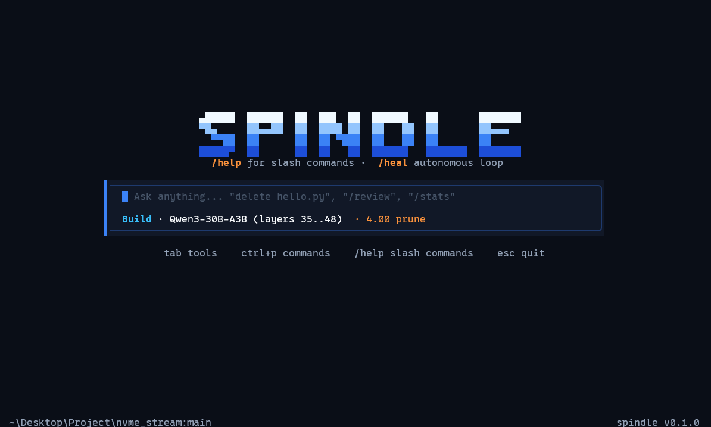

# spindle

Spindle runs GGUF language models on the CPU. It runs on one Windows PC, or splits a model
across two PCs on the same network so that together they hold a model neither could load
alone.



The whole engine is in this repository, written in Rust: the GGUF parser, the tokenizer, the
transformer and mixture-of-experts layers, the AVX2 kernels, the thread pool, the cluster
protocol and the coding agent. It doesn't use llama.cpp, BLAS or any ML framework. Its only
dependency is the `windows` crate.

It was built on, and for, an 8 GB IdeaPad (i5-13420H), where most local AI tools either crawl
or take the whole machine down with them.

## What it does

- **Two-PC inference.** The desktop runs some of the layers and the laptop runs the rest.
  Qwen3-30B-A3B (17.3 GiB at Q4_K_M) runs at about 8 tok/s across a 16 GB desktop and an
  8 GB laptop over Wi-Fi, with no disk paging on either machine. See
  [docs/cluster.md](docs/cluster.md).
- **Speculative decoding with no draft model.** Draft tokens come from earlier text in the
  conversation, and the model checks them all in one batched pass. The output matches normal
  decoding exactly. This helps most when the reply repeats existing text, such as code edits
  or quotes. See [docs/speculative_decoding.md](docs/speculative_decoding.md).
- **MoE expert pruning.** Optionally run fewer of the routed experts per token, for example
  4 of Qwen3's 8. This trades a little quality for speed. See
  [docs/moe_pruning.md](docs/moe_pruning.md).
- **A coding agent.** The model can read, search, edit and delete files and run commands.
  Every risky action asks you first, and `/undo` reverts edits. See [docs/agent.md](docs/agent.md)
  and [docs/security.md](docs/security.md).
- **Safe on small machines.** Weights are memory-mapped. The context is sized to fit free RAM,
  and a working-set governor stops a model larger than RAM from freezing the PC. See
  [docs/architecture.md](docs/architecture.md).

Supported models: Llama-style dense models (SmolLM2), Qwen2 and Qwen3 dense, Qwen3 MoE
(Qwen3-30B-A3B), and Granite MoE. Quantizations: `F32`, `F16`, `BF16`, `Q4_0`, `Q4_1`, `Q5_0`,
`Q5_1`, `Q8_0`, `Q4_K`, `Q5_K` and `Q6_K`. Each kernel is tested against a scalar reference.

## Requirements

- Windows 10 or 11 on x86-64
- A CPU with AVX2, FMA and F16C (Intel Haswell, AMD Zen or newer)
- [Rust](https://rustup.rs) stable, to build it

## Build

```powershell
git clone https://github.com/WiseHax/spindle.git
cd spindle
cargo build --release
```

The binary is `target\release\spindle.exe`.

## Quick start (one PC)

Download a small model and start chatting:

```powershell
Invoke-WebRequest "https://huggingface.co/Qwen/Qwen3-0.6B-GGUF/resolve/main/Qwen3-0.6B-Q8_0.gguf" -OutFile qwen3-0.6b-q8_0.gguf
.\target\release\spindle.exe qwen3-0.6b-q8_0.gguf
```

On startup, spindle shows each loading step with a progress bar where it can measure one:

```
  spindle 1.0.0

  ✓ Model      Qwen3 0.6B Instruct · 609 MiB · 28 layers  596 ms
  ✓ Weights    604 MiB in RAM · 1.7 GiB/s  353 ms
  ✓ Engine     4 compute threads · prompt-lookup speculation  0 ms
  ✓ Prompt     system prompt cached (37 tokens) · context 4,096 tokens  361 ms

  Ready in 1.3 s
```

With tools on, the system prompt is about 930 tokens, so the Prompt step takes longer: about
12 s for Granite 1B on the dev laptop with its weights paged in from disk. That work happens
once per session, not once per reply.

After that the full-screen interface opens. Type `/help` for the commands. Use `--no-tui`
for a plain line-based chat, or `--prompt "..."` to answer once and exit.

Without a model argument, spindle uses the `model` from `spindle.toml`. If that isn't set, it
uses the largest `.gguf` in the current folder.

## Two PCs

Copy the same GGUF to both machines. On the PC with more RAM (the worker), start a node that
serves the first layers:

```powershell
.\spindle.exe node Qwen3-30B-A3B-Q4_K_M.gguf --bind 0.0.0.0:42424 --layer-range 0..35 --wire-format fp8 --threads 5 --ctx 8192
```

Allow `spindle.exe` through the worker's firewall on private networks. Then, on the other PC
(the client), put the remaining layers and the worker's address in `spindle.toml`:

```toml
model = "Qwen3-30B-A3B-Q4_K_M.gguf"
peer = "192.168.1.10:42424"
layer_range = "35..48"
wire_format = "fp8"
threads = 4
moe_prune = 4
tools = true
speculate = true
ctx = 8192
```

and run `.\spindle.exe`. Both PCs must run the same spindle version. When the two PCs ask for
different context lengths, the client uses the smaller one.

How to choose the split, and what each frame on the wire does, is in
[docs/cluster.md](docs/cluster.md).

## Speed

Measured on the dev laptop: an i5-13420H (4 P-cores, 4 E-cores) with 8 GB of RAM, on
Windows 11. Settings were greedy, 128 tokens, and the prompt "Write a short paragraph about
how rivers shape valleys".

| Model | File | tok/s |
|---|---|---|
| SmolLM2-135M-Instruct | 101 MiB, Q4_K_M | 171 |
| SmolLM2-360M-Instruct | 368 MiB, Q8_0 | 57 |
| Qwen3-0.6B | 609 MiB, Q8_0 | 39 |
| Granite 3.1 1B-A400M (MoE) | 1.3 GiB, Q8_0 | 42 |
| Qwen3-30B-A3B (MoE), two PCs | 17.3 GiB, Q4_K_M | 7.2–8.2 |

The Qwen3-30B-A3B row used a 16 GB desktop (6 cores, layers 0..35) and the laptop (layers
35..48) over home Wi-Fi, with `moe_prune = 4`. A token took about 73 ms on the desktop and
31 ms on the laptop.

On ordinary prose, prompt-lookup speculation is roughly break-even, because few drafts
match. When the reply copies earlier text, it can double the speed: a copy task on
Qwen3-0.6B went from 14.7 to 32.5 tok/s. Numbers, method and how to reproduce them are in
[docs/benchmarks.md](docs/benchmarks.md).

## Options

`spindle --help` lists every option. The common ones:

| Option | `spindle.toml` key | Default | What it does |
|---|---|---|---|
| `--peer <ip:port>` | `peer` | | worker to connect to |
| `--layer-range <a..b>` | `layer_range` | all | layers this PC runs |
| `--bind <ip:port>` | | 127.0.0.1 | address a worker listens on |
| `--wire-format <fp8\|fp16\|fp32>` | `wire_format` | fp16 | how activations travel between the PCs |
| `--threads <n>` | `threads` | one per physical core | compute threads |
| `--ctx <n>` | `ctx` | 4096 | context length in tokens, capped by free RAM |
| `--moe-prune <x>` | `moe_prune` | 0 (off) | top x experts (x ≥ 1), or drop the tail past 1 − x of the router probability (x < 1) |
| `--no-spec` | `speculate = false` | on | turn off speculative decoding |
| `--draft <model.gguf>` | `draft` | | use a small model for drafts instead |
| `--tools` | `tools` | on in chat | let the model use files and the shell |
| `--think` | `think` | off | let Qwen3 reason before answering |
| `--no-tui` | `tui = false` | | line-based chat |
| `--reserve <MiB>` | | 512 | RAM to always leave free for other programs |
| `--ram-budget <MiB>` | | | hard cap on spindle's resident memory |
| `--verbose` | | | print load, memory and threading details |

Sampling options: `--temp` (0.6, and 0 means greedy), `--top-k` (40), `--top-p` (0.9),
`--min-p` (0.05), `--repeat-penalty` (1.1) and `--seed`.

## Checking against llama.cpp

`tools\golden.ps1` sends the same prompts through spindle and llama.cpp with greedy decoding.
It reports the first token where the two differ:

```powershell
.\tools\golden.ps1 -Model qwen3-0.6b-q8_0.gguf -Llama C:\llama\llama-completion.exe
```

## Source layout

| | |
|---|---|
| `src/smollm_chat.rs` | the engine: forward pass, MoE, KV cache, tokenizer, sampling, speculation |
| `src/quant.rs`, `src/quant_multi.rs` | quant formats and AVX2 kernels (one vector, and up to 8 sharing each block decode) |
| `src/cluster_net.rs` | the two-PC protocol, client and worker |
| `src/agent.rs`, `src/tools.rs`, `src/json.rs` | the agent loop, the tools and the tool-call parser |
| `src/guard.rs` | checks on commands and paths before tools run them |
| `src/tui.rs`, `src/chat_cli.rs` | the full-screen and line-based interfaces |
| `src/loading.rs` | the startup progress display |
| `src/mmap_file.rs`, `src/memory_guard.rs` | memory-mapped weights, warm-up and the working-set governor |
| `src/worker_pool.rs` | the thread pool for matrix-vector products |
| `src/gguf_loader.rs` | GGUF parser |
| `src/expert_pack.rs`, `src/expert_cache.rs`, `src/layer_stream.rs` | experimental disk-streaming paths |
| `src/main.rs` | command line, config file, CPU topology and startup |

[docs/architecture.md](docs/architecture.md) walks through how a token is produced.

## Status

Version 1.0.0. The changes are listed in [CHANGELOG.md](CHANGELOG.md), and the next steps are
in [docs/roadmap.md](docs/roadmap.md).

## Contributing

See [CONTRIBUTING.md](CONTRIBUTING.md).

## License

MIT. Model weights are not included and have their own licenses: Qwen3 and SmolLM2 are
Apache-2.0, and Granite is Apache-2.0.
